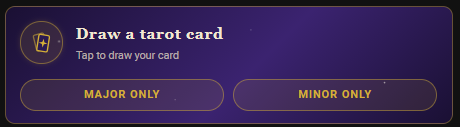
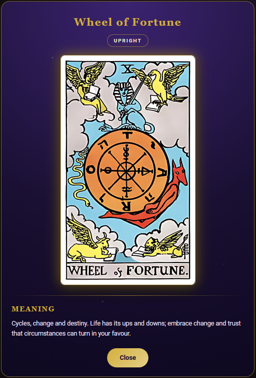

# HA Tarot Card

A standalone Lovelace custom card that draws a random tarot card and opens it in a dialog.

<p align="center">
  
  &nbsp;
  
</p>

## Features

- Includes all 78 card images (major and minor arcana)
- Reversed cards, like in real life, give a different interpretation
- Mystic dark-purple/gold design with a custom tarot-card icon, a card back and a card-flip reveal
- Visual editor in Home Assistant, no YAML needed
- Choose major arcana, minor arcana or both, with optional extra "major only" / "minor only" buttons
- Also available as a **badge** (`custom:tarot-badge`) for the top of a dashboard view
- Own purple/gold theme, or switch it off to follow your Home Assistant theme (card and badge)
- 7 languages included: English, Dutch, Spanish, German, French, Portuguese and Italian. Every text lives in its own language file

## Install with HACS

1. Go to Settings > Marketplace.
2. Add this repository's GitHub URL under "Add from link".
3. Find **HA Tarot Card** in HACS and install it.
4. Refresh the browser / Home Assistant app.

## Use the card

Add the card from the dashboard editor (**Add card → Tarot Card**) and use the visual editor, or use YAML.

Minimal configuration:

```yaml
type: custom:tarot-card
```

Dutch:

```yaml
type: custom:tarot-card
lang: nl
```

All options:

```yaml
type: custom:tarot-card
title: Draw a tarot card
subtitle: Tap to draw your card
icon: tarot
accent: "#d4af37"
lang: en
major_arcana: true
minor_arcana: true
arcana_buttons: false
themed: true
reversed_probability: 40
```

| Option | Default | Description |
|---|---|---|
| `title` | `Draw a tarot card` | Text shown on the card before drawing |
| `subtitle` | `Tap to draw your card` | Small text under the title. Use `false` to hide |
| `icon` | `tarot` | `tarot` = built-in tarot card icon, or any icon such as `mdi:cards-outline` |
| `accent` | `#d4af37` | Accent colour (gold by default) |
| `lang` | `en` | Language code. Built in: `en`, `nl`, `es`, `de`, `fr`, `pt`, `it`. See [Languages](#languages) |
| `major_arcana` | `true` | Include the 22 major arcana cards |
| `minor_arcana` | `true` | Include the 56 minor arcana cards |
| `arcana_buttons` | `false` | Show extra "Major only" / "Minor only" buttons. Only visible when both `major_arcana` and `minor_arcana` are enabled |
| `themed` | `true` | `true` = the card's own purple/gold theme. `false` = follow your Home Assistant theme (card, badge and buttons). The dialog keeps its design |
| `reversed_probability` | `40` | Chance (0–100) of drawing a reversed card |
| `image_path` | next to the card's JS file | URL path to the upright `.avif` images. Only change this if you host the images elsewhere |

At least one of `major_arcana` and `minor_arcana` must be enabled. If both are set to `false`, both are used.

## Use as a badge

Add it under `badges:` in a dashboard view (YAML mode) or pick it in the badge editor:

```yaml
badges:
  - type: custom:tarot-badge
    lang: nl
```

Icon only, with a different icon:

```yaml
badges:
  - type: custom:tarot-badge
    icon: mdi:cards-outline
    show_label: false
```

Without the purple/gold design, following your Home Assistant theme:

```yaml
badges:
  - type: custom:tarot-badge
    themed: false
```

The badge supports the same options as the card, except `subtitle` and `arcana_buttons`, plus:

| Option | Default | Description |
|---|---|---|
| `show_label` | `true` | Show the text next to the icon. Set to `false` for an icon-only badge |

The default badge label is `Tarot`; change it with `title`.

## Languages

All texts (interface, editor labels, card names and both interpretations) are stored per language, not in the JavaScript. These languages are included in `dist/lang/`:

| `lang` | Language | File |
|---|---|---|
| `en` | English | `en.json` |
| `nl` | Nederlands | `nl.json` |
| `es` | Español | `es.json` |
| `de` | Deutsch | `de.json` |
| `fr` | Français | `fr.json` |
| `pt` | Português | `pt.json` |
| `it` | Italiano | `it.json` |

Each file has the same structure:

```json
{
  "ui": { "upright": "...", "reversed": "...", "meaning": "...", "close": "...", "title": "...", "badge_title": "...", "hint": "...", "major_only": "...", "minor_only": "..." },
  "editor": { "title": "...", "subtitle": "..." },
  "cards": {
    "AceOfCups": { "name": "...", "meaning": "...", "meaning_reversed": "..." }
  }
}
```

To add another language, copy `en.json` to e.g. `ja.json`, translate the values (keep the keys and card ids), and use `lang: ja`. Missing texts fall back to English. `**bold**` in meanings is supported.

## Custom Images

All 78 upright card images are in `dist/tarot_cards/` as `.avif` files. Major and minor arcana are told apart by file name, so they all stay in one folder. Reversed cards are the same image, rotated. To add your own deck just copy the filenames and use the `image_path` key.
